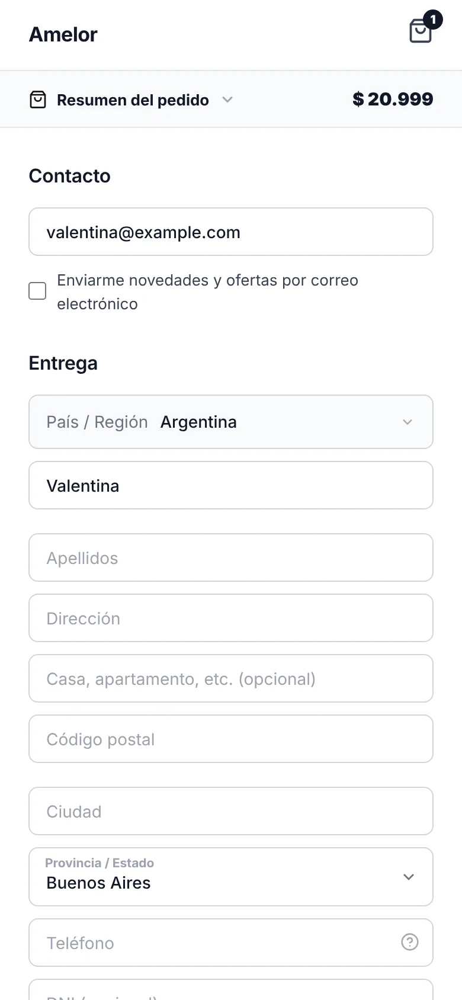
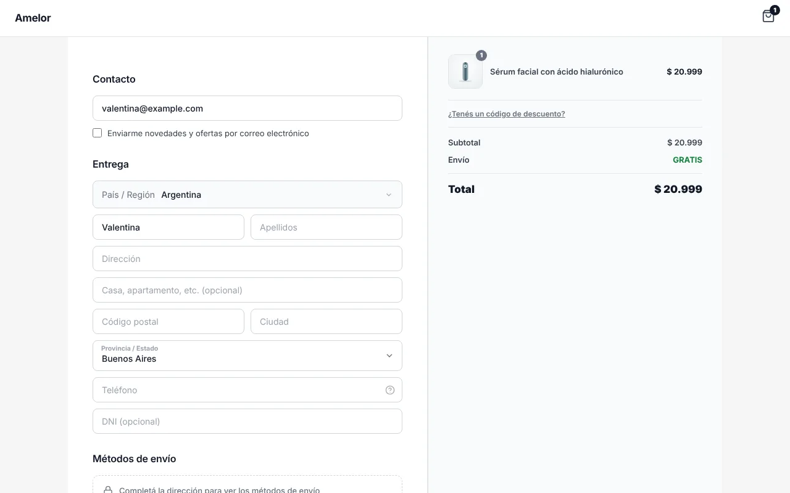
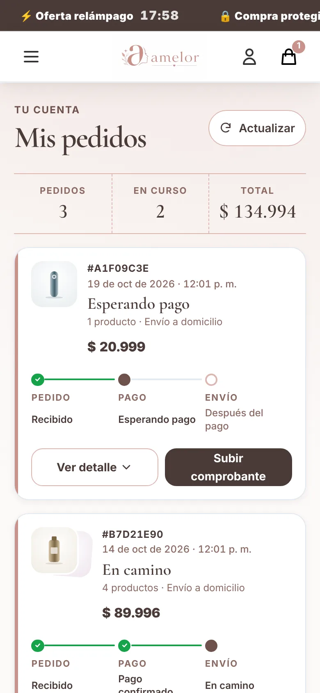
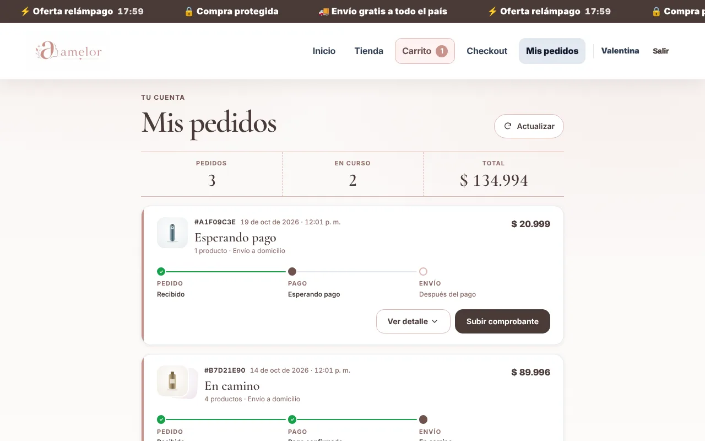
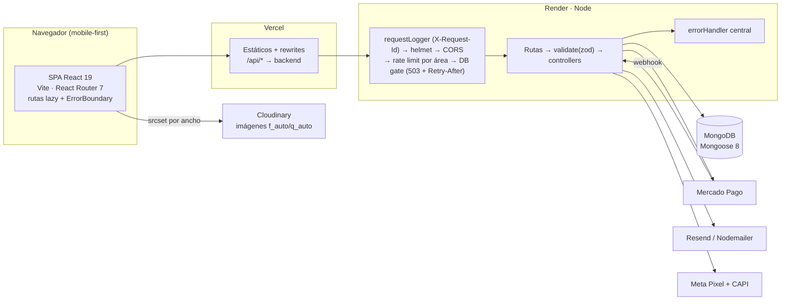

# Amelor — ecommerce full stack

[](https://github.com/HRicardoMorales/BoomHausS/actions/workflows/ci.yml)


Tienda online en producción para el mercado argentino: catálogo, fichas de producto, **11 landings de campaña** para tráfico de Instagram/Facebook, carrito con packs y promos, checkout con Mercado Pago, seguimiento de pedidos y panel de administración.

No es un proyecto de tutorial: tiene tráfico real, pagos reales y el tipo de deuda que aparece cuando un negocio crece rápido. Este README cuenta qué se construyó y, sobre todo, **cómo se llevó de "funciona" a "se puede mantener"** con números medibles.

**Demo en vivo:** [amelor.com.ar](https://amelor.com.ar)

---

## Contenido

- [Capturas](#capturas)
- [Qué hay adentro](#qué-hay-adentro)
- [Arquitectura](#arquitectura)
- [Stack](#stack)
- [Decisiones técnicas](#decisiones-técnicas)
- [Números](#números)
- [Correrlo localmente](#correrlo-localmente)
- [Tests y CI](#tests-y-ci)
- [Estructura del repo](#estructura-del-repo)

## Capturas

Generadas por `npm run screenshots` sobre el build de producción (API mockeada, sin backend; fotos de producto vectoriales para que sean reproducibles sin red).

| | Mobile (390 px) | Desktop (1280 px) |
| --- | --- | --- |
| **Home** |  |  |
| **Ficha de producto** |  |  |
| **Landing de campaña** |  |  |
| **Checkout** |  |  |
| **Mis pedidos** |  |  |

## Qué hay adentro

| Área | Lo que hace |
| --- | --- |
| **Home** | Hero editorial con promesa concreta, destacados reales, opiniones, catálogo con filtro por categoría (píldora animada), videos de uso, beneficios, antes/después, garantía y newsletter. |
| **Landings** | 11 páginas de venta (`/lp/*`) construidas sobre plantillas (`ShowcaseLanding`, `WineLanding`) + una librería de secciones compartidas (`components/landing/`): FAQ accesible, reseñas con barras, contador, antes/después, videos que solo se reproducen en pantalla. |
| **Carrito** | Packs, "Lleva 2" por pares, cupones, upsell. La matemática de precios es una función pura con tests (`utils/cartMath.js`). |
| **Checkout** | Formulario con validación, envíos, Mercado Pago, transferencia con comprobante y pantalla de resultado con verificación contra el backend. |
| **Mis pedidos** | Línea de tiempo Pedido → Pago → Envío derivada de funciones puras (`orderStatus.js`). |
| **Admin** | Productos, pedidos (verificación de comprobantes), cupones, carritos abandonados y métricas. |

## Arquitectura



**Flujo de una compra:** el carrito vive en `CartContext` (persistido en `localStorage` con rehidratación tolerante a datos corruptos) → `/checkout` valida los campos en el cliente (`CheckoutField` con `aria-invalid`/`aria-describedby`) → `POST /api/orders` pasa por el rate limit de órdenes y por el schema zod de contacto/envío → el controller crea el pedido (idempotente por `clientOrderId`) y la preferencia de Mercado Pago → el webhook de MP actualiza el estado → `SuccessPayment` verifica contra el backend antes de vaciar el carrito y disparar el evento de compra.

## Stack

**Frontend** — React 19, Vite 7, React Router 7, Framer Motion 12 (`LazyMotion`, features en chunk aparte), Embla Carousel, Axios. Fuentes variables self-hosteadas con `@fontsource-variable`. Tokens de diseño en CSS custom properties.

**Backend** — Node 22, Express 5, Mongoose 8, zod 4, JWT (header `Bearer` o cookie), bcrypt, helmet, express-rate-limit, multer + Cloudinary, Resend/Nodemailer, node-cron, SDK de Mercado Pago.

**Calidad** — ESLint 9 (`react`, `react-hooks`, `jsx-a11y` en 0 avisos), Vitest 4 + Testing Library, `node:test` + supertest, axe-core + Playwright para accesibilidad, GitHub Actions.

## Decisiones técnicas

Cada una resolvió un problema concreto que estaba en el código.

### Performance

- **Code splitting por ruta con reintento.** Todas las rutas salvo la home son `React.lazy`. `utils/lazyWithRetry.js` recarga una vez si un chunk ya no existe después de un deploy (el clásico "Failed to fetch dynamically imported module"), y la ficha de producto se precarga en idle. En el camino apareció un bug real: el handler de `vite:preloadError` cancelaba también los fallos del JS, el `import()` resolvía `undefined` y React rompía con *reading 'default'* sin reintentar.
- **El chunk inicial no paga por las landings.** Con `source-map-explorer` se vio que los configs de las 14 landings (~170 KB) entraban al bundle inicial a través de `ProductCard → landings/catalog.js`. Separarlo bajó el entry un 49 %.
- **Framer Motion bajo demanda.** `MotionProvider` usa `LazyMotion strict` y pide las features (`domAnimation`, 14 KB gz) después del primer render, con `reducedMotion="user"` y un respaldo CSS si el chunk no llega.
- **Imágenes responsive sin backend de imágenes propio.** `utils/imageCdn.js` arma `srcset` para Cloudinary (`f_auto,q_auto,w_N` encadenado a transformaciones existentes), Shopify (`?width=N`, sin GIF para no congelar la animación) y Twitter (variantes nominales). `SafeImg` agrega `width/height`, `sizes` y `priority` (eager + `fetchpriority="high"`) para el LCP.
- **Videos que no bajan hasta que se ven.** `ProofVideoStrip` usa `preload="none"` y reproduce por `IntersectionObserver`; antes la home bajaba 3 mp4 1080p al cargar.

### Arquitectura del frontend

- **De copias a componentes.** La ficha de producto pasó de **5.008 a ~800 líneas**; `MundialLanding` de **3.725 a 415**; dos landings de ~620 líneas cada una son ahora wrappers de 15 líneas sobre una plantilla con `config` + `theme`. Secciones que estaban copiadas 4 o 5 veces (contador, FAQ, reseñas, barra de compra fija, estadísticas) viven una sola vez en `components/landing/`.
- **CSS con dueño.** Más de 5.000 líneas de `<style>` inline salieron a archivos por componente bajo `:where(.raiz)` (sin subir especificidad ni filtrarse). `index.css` pasó de 1.961 a 742 líneas tras borrar 280 reglas sin uso detectadas con un script de PostCSS.
- **Design system en 3 capas** (`styles/tokens.css`): primitivos → semánticos (`--color-*`, `--surface-*`) → escalas (tipografía fluida con `clamp`, espaciado base 4, radios, sombras, z-index).
- **Layout declarativo.** Qué rutas muestran header, footer o marquee se resolvía con cuatro cadenas de `||` en `App.jsx`; ahora es `getLayoutChrome(pathname)` con default ← prefijos ← rutas exactas, verificado por script contra la lógica anterior en 23 rutas.
- **Lógica pura, vista tonta.** Precios (`cartMath`), estados de pedido (`orderStatus`), envíos (`shipping`) y pruebas sociales (`homeProof`) son funciones puras testeadas; los componentes solo las muestran.

### Backend

- **Validación en el borde con zod.** Un middleware `validate({ body, params, query })` devuelve `400 { ok, message, fields }` y entrega al controller el input ya parseado, sin claves desconocidas. Cerró **tres inyecciones NoSQL** reales: login y recuperación de contraseña (`{"email": {"$ne": null}}` llegaba directo a `findOne`) y la idempotencia de órdenes (`clientOrderId: {"$ne": null}` devolvía un pedido ajeno).
- **Ids mal formados → 400, no 500.** `validateObjectId` antes de cada ruta con `:id`.
- **DB gate.** Si Mongo no está listo, `/api/*` responde `503` con `Retry-After` de inmediato en vez de colgar la request hasta el timeout de Mongoose. `/api/health` refleja el mismo estado.
- **Observabilidad básica.** Logger con scopes (`logger.child('orders')`) y `X-Request-Id` por request; manejo de errores centralizado.
- **Rate limit por área**: general, auth (más estricto) y órdenes.

### Accesibilidad

- `eslint-plugin-jsx-a11y` en **0 avisos** y `npm run a11y`: axe-core sobre el build de producción con la API mockeada y hosts externos bloqueados, en 15 rutas. Sale con código 1 ante violaciones *serious/critical*.
- Controles reales en lugar de `div` clickeables: packs y medios de pago son `<label>` + radio nativo en un `radiogroup`, el FAQ usa botones con `aria-expanded`, las barras fijas ocultas son `inert`.
- Contraste AA en las 11 landings, skip-link, `:focus-visible` consistente y `prefers-reduced-motion` respetado en todas las animaciones.

## Números

| Métrica | Antes | Ahora |
| --- | --- | --- |
| JS inicial (gzip) | 391 KB (1.462 KB sin comprimir) | **~128 KB** (`vendor-react` 73 KB + entry 55 KB), el resto por ruta |
| CSS inicial | 53,9 KB | 35,9 KB |
| Assets en el repo | ~17 MB (instaladores, PNG de 2 MB como logo) | logos WebP de ~4,5 KB |
| `ProductDetail.jsx` | 5.008 líneas | ~800 |
| `MundialLanding.jsx` | 3.725 líneas | 415 |
| ESLint | 94 errores | 0 (incluye `jsx-a11y`) |
| Tests | 0 | 52 frontend + 65 backend |

Los tamaños de bundle se publican en cada corrida de CI (resumen del job de frontend).

### Lighthouse (laboratorio, sin maquillaje)

Medido con [Lighthouse CI](frontend/lighthouserc.cjs) sobre el build de producción: perfil mobile de Lighthouse (Moto G Power, 4G lenta simulada, CPU ×4), mediana de 3 corridas, API mockeada en el mismo origen y hosts externos bloqueados para que el número dependa del código y no de la red. Pesos transferidos con gzip. "Antes" = primera medición (2026-10-27); "ahora" = runner de GitHub Actions sobre `df8bf74` (2026-10-28).

| Ruta | Perf antes → ahora | TBT antes → ahora | CLS antes → ahora | LCP | A11y | SEO | JS | Total |
| --- | --- | --- | --- | --- | --- | --- | --- | --- |
| `/` | 60 → **88** | 1,4 s → **39 ms** | 0,017 | 3,5 s | 100 | 100 | 227 KB | 407 KB |
| `/products/:id` | 49 → **86** | 0,5 s → **27 ms** | 1,30 → **0** | 3,9 s | 100 | 100 | 218 KB | 395 KB |
| `/lp/escultor-led` | 74 → **81** | 0,5 s → **107 ms** | 0,001 → 0 | 4,8 s | 96 | 100 | 238 KB | 454 KB |
| `/cart` | 77 → **93** | 0,4 s → **44 ms** | 0 → 0,055 | 3,0 s | 100 | — (noindex) | 222 KB | 401 KB |

Cómo se bajaron (detalle en el historial): el **CLS de la ficha** venía del footer pintándose mientras cargaba el producto → esqueleto con las medidas reales del hero. El **TBT de la home** eran tres cosas medidas con traces de Chromium: el render del catálogo como una sola tarea larga (ahora en `startTransition`), Embla midiendo los slides en el mismo commit y forzando un layout de toda la página (ahora engancha en idle) y un `MutationObserver` global, código muerto, que corría `querySelectorAll` en cada tic del countdown.

El job `lighthouse` de CI **falla** si el JS, el CSS o el peso total crecen más de ~15 %, si el LCP pasa de 5 s, si aparece CLS, si el TBT supera 300 ms o si baja la accesibilidad o el SEO; el score, que depende de la CPU del runner, solo avisa. Reportes HTML como artifact del job.

## Correrlo localmente

Requisitos: Node 22 y una base de MongoDB (local o Atlas).

```bash
git clone https://github.com/HRicardoMorales/BoomHausS.git
cd BoomHausS

# Backend → http://localhost:<PORT>
cd backend
npm ci
cp .env.example .env   # completá MONGO_URI y JWT_SECRET
npm run seed:products  # datos de ejemplo
npm run dev

# Frontend → http://localhost:5173
cd ../frontend
npm ci
npm run dev
```

Variables mínimas del backend: `MONGO_URI`, `JWT_SECRET`, `PORT`. Mercado Pago, Cloudinary, mail y Meta son opcionales para navegar el sitio; sin ellas esas integraciones quedan inactivas. El frontend tiene su propio `frontend/.env.example` (`VITE_STORE_NAME`, `VITE_WHATSAPP_NUMBER`, `VITE_SUPPORT_EMAIL`, `VITE_META_PIXEL_ID`; todas opcionales) y en el build de Vercel se puede definir `SITE_URL` para las URLs absolutas de SEO.

> Sin `MONGO_URI` el backend igual levanta: la API responde `503` con `Retry-After` gracias al DB gate, y los tests corren así.

## Tests y CI

```bash
# Frontend
cd frontend
npm run lint
npm test          # Vitest: precios, carrito, estados de pedido, envíos
npm run build
npm run a11y      # axe sobre el build (requiere Chromium)
npm run smoke     # E2E: 27 rutas × 390/1280 px — errores, <main>, desborde, ids duplicados
npm run lhci      # Lighthouse CI con presupuestos (CHROME_PATH si no hay Chrome instalado)
npm run screenshots  # capturas del README en docs/screenshots (--images=live para fotos reales)

# Backend
cd backend
npm test          # node:test + supertest sobre app.js real, sin Mongo ni red (~2 s)
```

Los tests del backend corren contra el `app.js` real con los modelos mockeados: verifican, por ejemplo, que una inyección `{"$ne": null}` devuelva 400 **sin llegar a llamar al modelo**. Se validaron con mutaciones de control (romper el código a propósito y comprobar que el test falla).

[`.github/workflows/ci.yml`](.github/workflows/ci.yml) corre en cada push y PR: frontend (`npm ci` → lint → knip → Vitest → build + tabla de tamaños gzip), **E2E** (build → `npm run smoke` en Chromium sobre todas las rutas, incluido el admin con sesión falsa, + axe WCAG 2.1 AA del recorrido de compra a 390 y 1280 px), **Lighthouse** (presupuestos de peso, LCP y CLS en 4 rutas, tabla en el resumen del job) y backend (`npm ci` → `node --check` sobre todo `src/` → `node:test`), en paralelo, con caché por lockfile y sin secretos.

El smoke no se queda en "la página cargó": como `#root` tiene `overflow-x: clip`, un elemento más ancho que el celular no genera scroll sino que queda **cortado sin que nadie lo note**; el script busca elementos que se salen del viewport sin un ancestro que los recorte a propósito (carruseles), además de excepciones sin atrapar, `<main>` sin montar e `id` duplicados. Verificado inyectando cada falla en el build.

## Estructura del repo

```
backend/
  src/
    app.js              # middlewares y montaje de rutas (sin listen → testeable)
    server.js           # arranque
    routes/  controllers/  models/
    middlewares/        # auth, validate (zod), validateObjectId, errorHandler, requestLogger
    validation/         # schemas zod por recurso
    services/           # Cloudinary, email, Meta CAPI
  test/                 # node:test + supertest
frontend/
  src/
    pages/              # una por ruta (lazy)
    components/
      home/  landing/  product/  checkout/  orders/  payment/  motion/  ui/
    landings/           # configs de cada landing (datos, no código)
    hooks/  utils/  context/  routes/  styles/
  scripts/a11y.mjs      # auditoría axe sobre el build
  scripts/smoke.mjs     # E2E smoke de todas las rutas (CI)
  scripts/screenshots.mjs  # capturas mobile/desktop para el README
  scripts/lib/harness.mjs  # preview + API mockeada compartidos por los tres
.github/workflows/ci.yml
```

---

Hecho por **Ricardo Morales** · [GitHub](https://github.com/HRicardoMorales)
